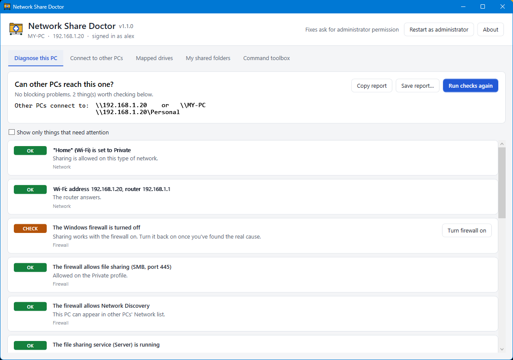
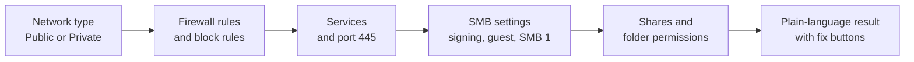
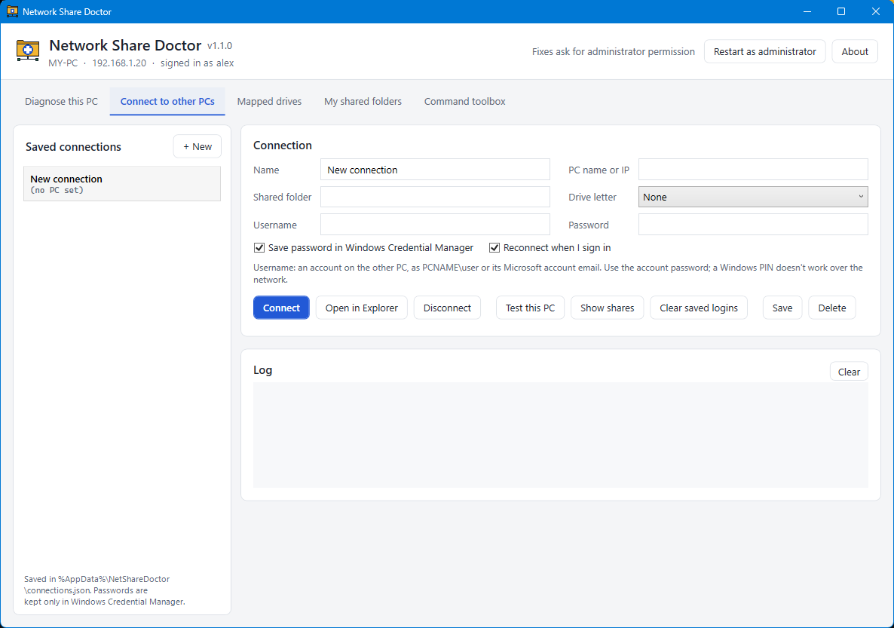
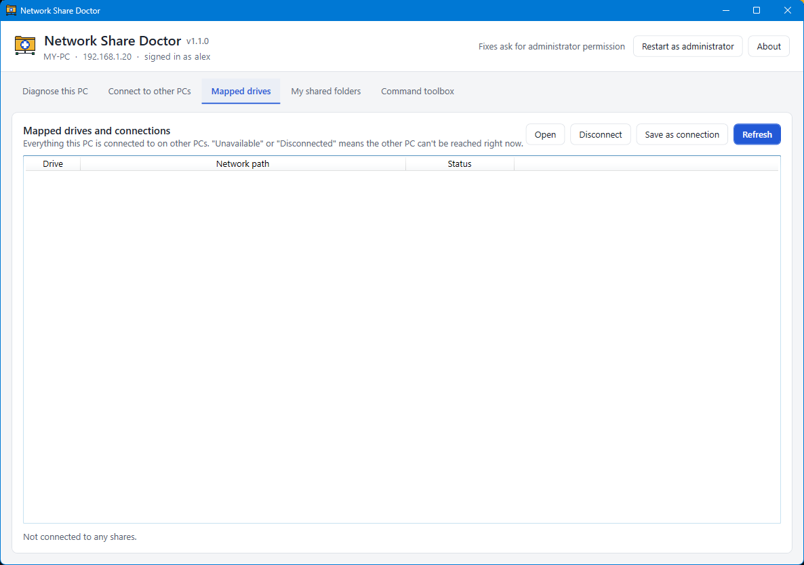
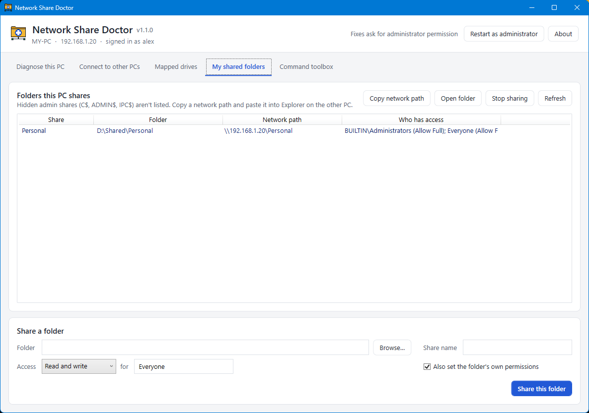
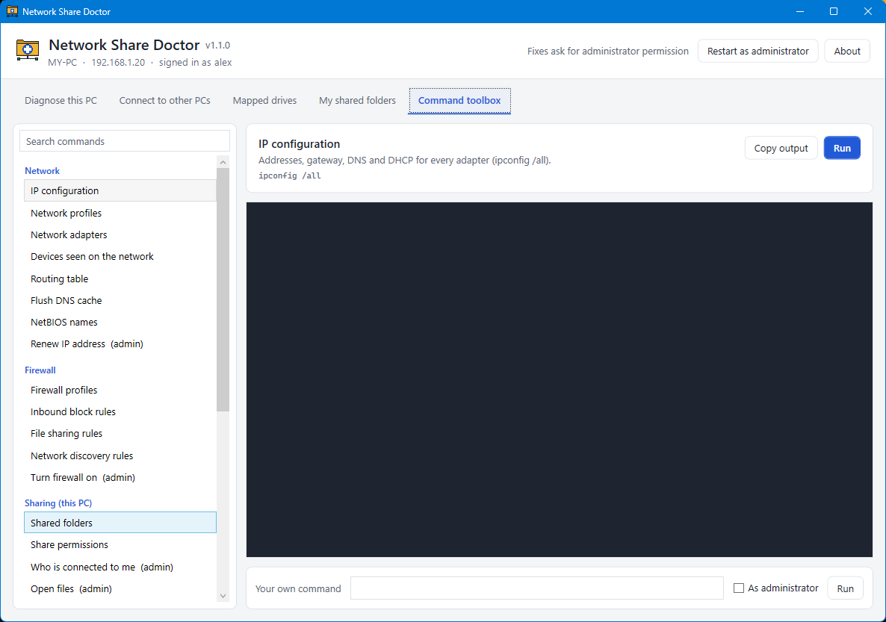

<p align="center">
  
</p>

<h1 align="center">Network Share Doctor</h1>

<p align="center">Find out why Windows PCs can't see each other's shared folders, and fix it in one click.</p>

<p align="center">
  <a href="LICENSE"></a>
  
  
  <a href="https://github.com/djgene01/NetShareDoctor/releases"></a>
</p>

<p align="center">
  
</p>

A Windows desktop app that finds out why PCs can't see or open each other's shared folders, fixes it with one click, and makes connecting to shares painless.

Windows file sharing (SMB) breaks in quiet ways: a network set to Public, a stray firewall block rule, a stopped discovery service, a Windows PIN used as a password, a signing mismatch. Windows' own error messages rarely say which. This app checks all of them and explains the result in plain words.

## What it checks



## Features

**Diagnose this PC.** Answers "can other PCs reach this one?" It checks:

- network type (Public / Private), IP address, router reachability, connected VPNs
- firewall state, the File and Printer Sharing and Network Discovery rules, and any inbound **block rule** that covers your local network (block rules beat allow rules)
- the Server, Workstation and discovery services, and whether port 445 is listening
- SMB 1/2/3, SMB signing, guest-share settings
- your shared folders, plus a self-test that opens one through the network address
- which username other PCs should sign in with (local account or Microsoft account)
- whether each shared folder's own (NTFS) permissions include the accounts it's shared with

Each problem has a fix button. Fixes ask for administrator permission through UAC, and the few that lower security (allow unsigned connections, allow guest shares, disable a firewall rule) ask you to confirm first. "Copy report" puts the full result on the clipboard; "Save report…" writes it to a text file.

**Connect to other PCs.** Saves connections (PC, share, username, drive letter):

- *Test this PC* checks the name lookup, ping, port 445 and 139, and whether the PC is on the same network
- *Show shares* lists that PC's shared folders; click one to use it
- *Connect*, *Disconnect*, *Open in Explorer*
- *Clear saved logins* fixes "already connected with a different account" (error 1219)
- error numbers (53, 67, 86, 1219, 1272, 1326, …) are explained in plain language

Passwords are never written to the app's files or put on a command line: connecting uses the Windows networking API directly. If you choose, they're stored in Windows Credential Manager, and deleting a connection can delete its saved password too.



**Mapped drives.** Every connection with its status. Open it, disconnect it, or save it as a connection.



**My shared folders.** Share a folder (read-only or read-write, for Everyone or one account). It can set the folder's own (NTFS) permissions too, because Windows checks both. You can also stop sharing and copy the network path.



**Command toolbox.** About 30 diagnostic commands in groups, each with a short description: ipconfig, devices on the network, routes, firewall rules, who is connected to me, open files, failed sign-ins, saved credentials, SMB logs, and so on. Type in the search box to filter them. You can also run your own command, as administrator if needed.



## Download

Get the latest version from the [Releases page](https://github.com/djgene01/NetShareDoctor/releases).

Current version: **1.1.0**. Windows 10 or 11, x64. Both downloads are self-contained, so no .NET install is needed.

- **Installer:** `NetShareDoctor-<version>-win-x64.msi` installs to Program Files and adds Start menu and desktop shortcuts. Installing a newer version upgrades in place; uninstall from Settings → Apps. Your saved connections in `%AppData%\NetShareDoctor` are kept. To skip the desktop shortcut: `msiexec /i NetShareDoctor-<version>-win-x64.msi INSTALLDESKTOPSHORTCUT=0`.
- **Portable:** `NetShareDoctor-<version>-win-x64.zip`. Unzip it and run `NetShareDoctor.exe`.

The MSI and the exe aren't code-signed, so Windows SmartScreen may warn the first time ("More info" → "Run anyway").

## Build from source

Requires the [.NET 10 SDK](https://dotnet.microsoft.com/download). The installer uses WiX 5, which `dotnet build` downloads from NuGet.

```powershell
dotnet run --project NetShareDoctor -c Release
dotnet test NetShareDoctor.sln
```

Make the release (runs the tests, publishes the exe, then writes the zip and the MSI to `dist/`):

```powershell
./build.ps1
```

The version comes from `<Version>` in `NetShareDoctor/NetShareDoctor.csproj`.

## How it works

The app is WPF on .NET 10 with no third-party packages. Checks run Windows PowerShell's built-in cmdlets (`Get-NetConnectionProfile`, `Get-NetFirewallRule`, `Get-SmbServerConfiguration`, …) and `net.exe`. Connecting, disconnecting and saving passwords call the Windows API (`WNetAddConnection2`, `CredWrite`). Fixes run in a separate elevated PowerShell. You can read the exact command for every fix by hovering its button.

| Path | Contents |
| --- | --- |
| `NetShareDoctor/Services/Diagnostics.cs` | the checks for this PC and their fixes |
| `NetShareDoctor/Services/RemoteTester.cs` | testing another PC and listing its shares |
| `NetShareDoctor/Services/SmbClient.cs` | connecting, disconnecting and clearing saved sign-ins |
| `NetShareDoctor/Services/Native.cs` | the Windows API calls behind it |
| `NetShareDoctor/Services/ToolCatalog.cs` | the command toolbox list |
| `NetShareDoctor/Services/NetInfo.cs` | plain-language meanings of error numbers |
| `NetShareDoctor/Pages/` | the five tabs |
| `NetShareDoctor/Assets/` | the app icon and splash screen |
| `NetShareDoctor.Tests/` | xUnit tests |
| `installer/` | the WiX MSI project, its license page and its artwork |
| `art/` | the Pixel Art Studio source files (`.pxs`) for the icon, splash and installer art |
| `docs/` | the screenshots used in this README |
| `build.ps1` | builds the release zip and MSI |

Saved connections are kept in `%AppData%\NetShareDoctor\connections.json`.

## License

[MIT](LICENSE) © 2026 djgene01
